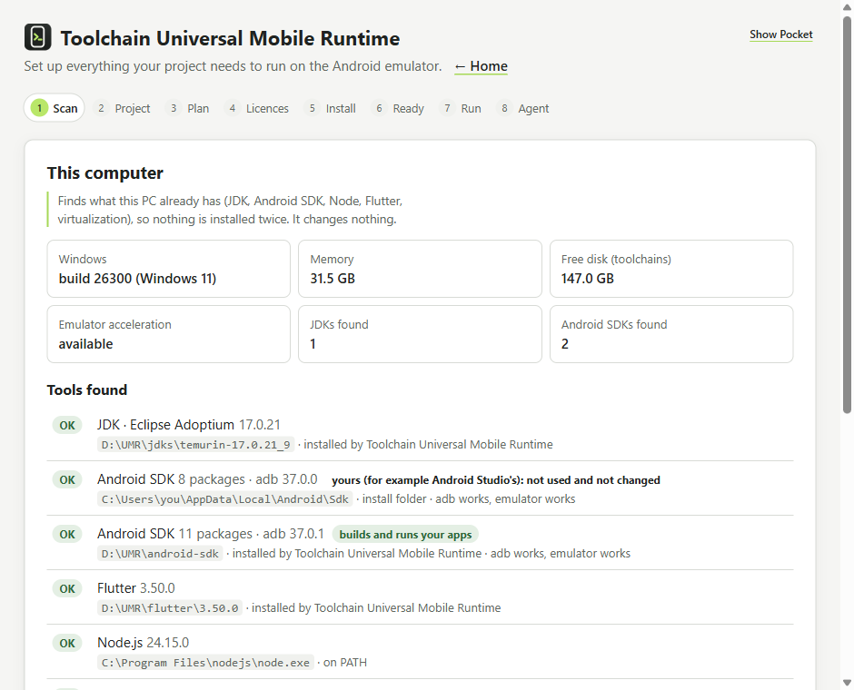
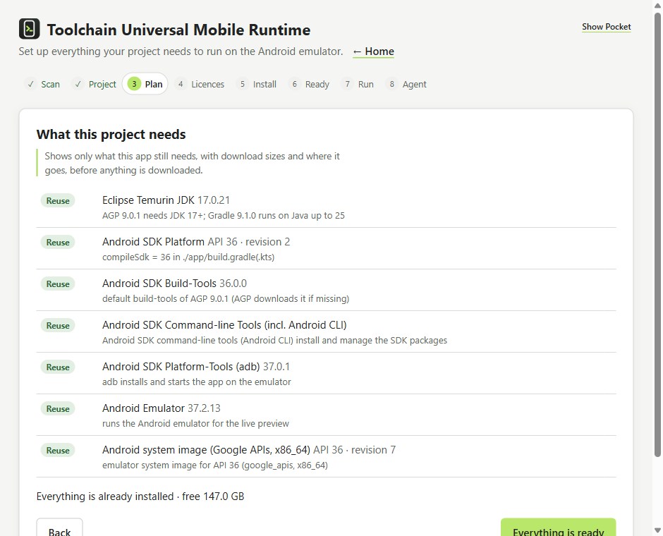
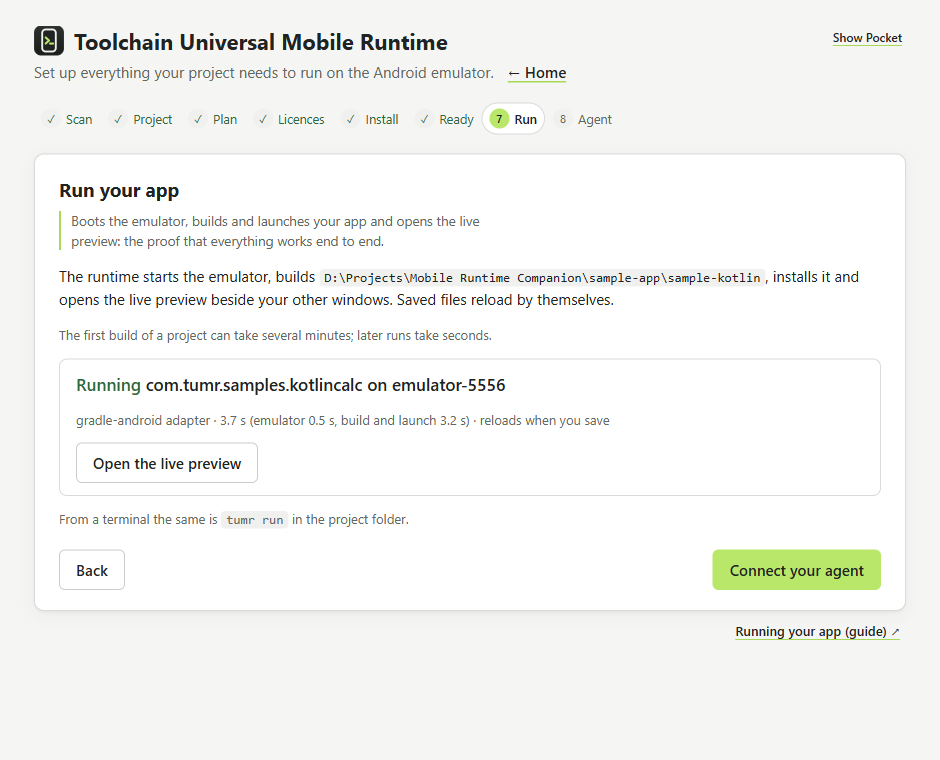
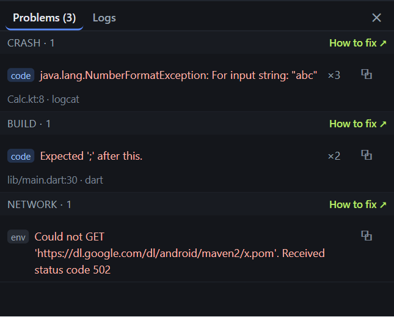
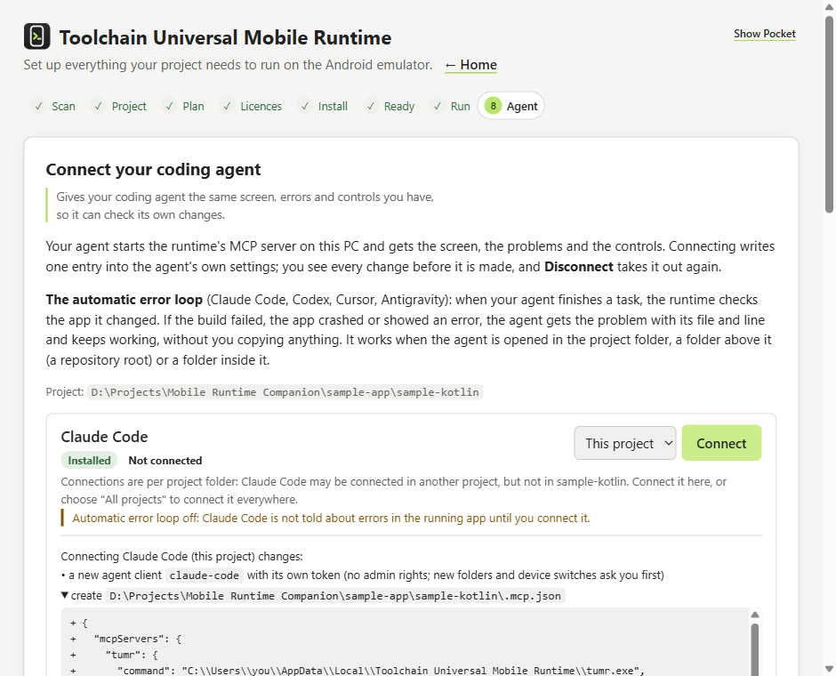

# Getting started

From nothing to your app in the preview with an agent fixing a bug — about 15 minutes plus download time.

## 1. Install
1. Download `Toolchain-Universal-Mobile-Runtime_<version>_x64-setup.exe` (or the portable ZIP).
2. Check the file: `Get-FileHash .\Toolchain-Universal-Mobile-Runtime_<version>_x64-setup.exe` must print the SHA-256 published with the release.
3. Run it. It installs for your Windows user only (no administrator rights) into `%LOCALAPPDATA%\Toolchain Universal Mobile Runtime` and adds a Start menu entry.

> Until releases are code-signed, Windows SmartScreen shows "Windows protected your PC". Choose **More info → Run anyway** only if the checksum matched.

The installer contains three programs: the desktop app, `tumr` (the command line tool) and `tumr-core` (the Runtime Core, which runs in the background and owns devices and sessions). The installer does not change your `PATH`. To use `tumr` from any terminal, tick **Use `tumr` in any terminal** on the app's Home screen, or run `tumr path add` once (by its full path); `tumr path remove` takes it out again. Only your user `PATH` changes, and new terminals see it.

## 2. First setup (the wizard)
Start **Toolchain Universal Mobile Runtime** from the Start menu. The wizard:
1. **Scans** your PC (Windows build, virtualization, RAM, disk, existing JDKs, SDKs, Node, Flutter, Git). Nothing is changed.

   

2. Asks for a **project folder** and detects the framework (Kotlin/Java, Flutter, React Native, Expo).
3. Shows the **plan**: only what that project still needs (JDK, Android SDK packages, emulator image, Flutter, Git for Flutter, Node …), with sizes and where it goes. Existing installs are reused, read-only.

   

4. Shows each third-party **licence** (Android SDK, JDK …) for you to accept.
5. **Installs**, resumable, verifying every download (and the publisher's signature on the JDK, Node.js, Git and Android tools). If Windows Hypervisor Platform is off, it asks once for administrator approval and a restart, then continues where it stopped.
6. **Ready** checks every installed tool and tells you if one needs repair (run the setup again to fix it).
7. **Runs your app**: the **Run** step starts the emulator, builds and installs the project, and opens the live preview. The first build of a project can take several minutes.

   

8. **Connects your coding agent**: the **Agent** step lists the coding agents on your PC (Claude Code, Codex, Cursor, Claude Desktop, VS Code, Antigravity) and connects the one you choose, showing every file it changes first (see step 4 below).

Every step has a link to the part of this guide that explains it.

The same works from a terminal: `tumr doctor`, `tumr plan <folder>`, `tumr install <folder>`.

## 3. Your first app
The wizard's **Run** step does this for you. In a terminal, inside your project folder:

```powershell
tumr trust .        # once per folder: allows its build scripts to run
tumr run            # builds, boots a phone, installs, launches, opens the preview
```

The preview docks on the right of your screen, inside a phone body with thin bezels and a punch-hole front camera. Click and type in it like on a phone; the toolbar has back, home, recents, rotate, screenshot, reload, and **☰ / ⚠** for problems and logs.

Working in VS Code? The [VS Code extension](vscode.md) does the same from the Command Palette and shows the phone in a panel beside your code.

### Fingerprint login
When the phone shows its lock screen, or your app asks for a fingerprint (`BiometricPrompt`), an in-display fingerprint sensor appears near the bottom of the screen. Hold it with the mouse to put a finger on the sensor; it lights up while touched and disappears again once the phone is unlocked. To test fingerprint login in your app:

1. Set a screen lock on the emulator (Settings › Security & privacy › Device unlock › Screen lock, a PIN is enough).
2. Settings › Device unlock › Fingerprint: each time it says *Touch the sensor*, hold the sensor in the preview (or run `tumr device fingerprint`). Three touches enrol finger 1.
3. Lock the phone (power key) or open your app's fingerprint prompt, then touch the sensor: it unlocks or passes authentication.

`tumr device auth` shows whether the phone is locked, whether something waits for a finger, and how many are enrolled; `tumr device fingerprint down` / `up` hold the finger. Agents use the `fingerprint` tool. The emulator's own image keeps its sensor "on the back of the phone" in Settings texts; the preview draws it on the screen, as on current phones.
Saved files reload by themselves: Flutter hot reload, Metro Fast Refresh, and for Kotlin/Java an incremental Gradle rebuild and reinstall (about 15–20 s). `tumr reload full` forces a rebuild.



`tumr session follow` prints the session's state each time it changes (device, app, problems) until you press Ctrl+C.

Other phone sizes: `tumr run --profile large` (or `compact`, `standard`, `fold`, `flip`, `tablet`), or the device menu in the preview.

## 4. Connect your agent
```powershell
tumr agent setup claude-code     # or: codex, cursor, claude-desktop, vscode
```
It shows exactly what it will write (the MCP server entry and short instructions for the agent) and asks first. The wizard's **Agent** step does the same with buttons:


 Start your agent in the project folder; for Claude Code, approve the `tumr` MCP server when asked (`/mcp` lists it).

Claude Code, Codex, Cursor and Antigravity also get a **stop hook**: when the agent says it is done, the runtime waits for the rebuild its last saves started and, if the app does not build or crashed, hands the error (file, line, message) back to the agent so it fixes it before stopping. See [Agents](agents.md#problems-go-back-to-the-agent).

Then ask your agent something like: *"The app is running in the Toolchain Universal Mobile Runtime preview. Tapping the + button does nothing — find the problem with the tumr tools, fix it and check the screen."* The agent will read the runtime status, open the problem, edit the code, reload and look at a screenshot. See [Agents](agents.md).

## 5. When something goes wrong
`tumr problems` lists what failed, classified and with file and line; `tumr logs -f` follows the app's log. The [troubleshooting guide](troubleshooting.md) has the common causes; in the preview window's Problems panel, **How to fix** opens its section for that kind of problem.

## Updates
`tumr update --check` tells you whether a newer version exists; `tumr update` downloads it, checks its checksum and installs it. Updates are checked only when you ask, against the release channel in `%USERPROFILE%\.tumr\config.toml` (`[update] manifest_url`).
